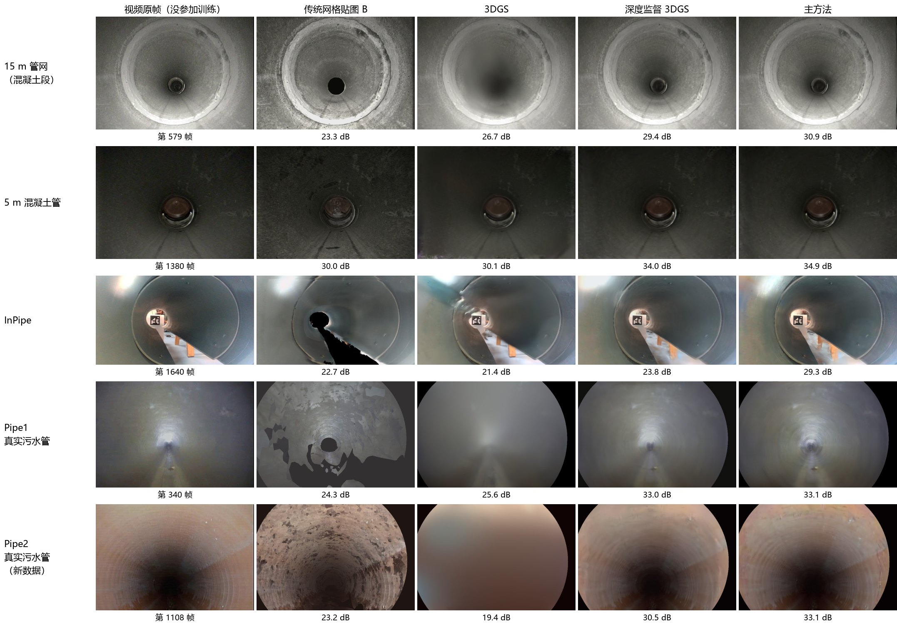
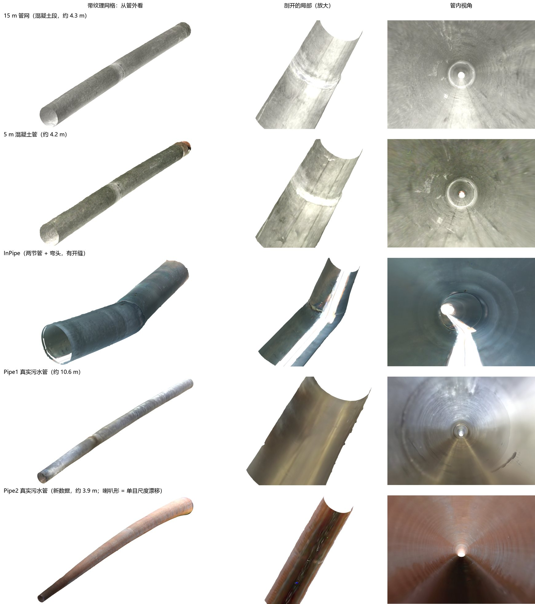
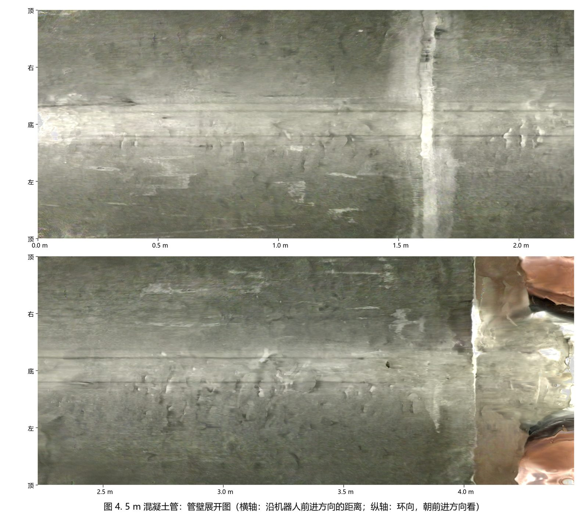
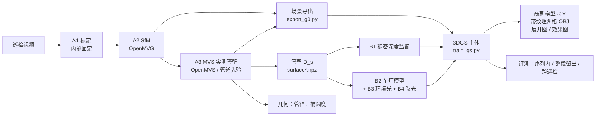

# PipeRecon3D — 管道内窥视频的三维重建（几何监督的高斯泼溅 + 近场照明模型）

> **English summary.** 3-D reconstruction of sewer / drain pipes from a monocular, forward-looking CCTV inspection video.
> Front end: fixed-intrinsics OpenMVG SfM + OpenMVS MVS (camera poses and the measured pipe wall). Model: 3D Gaussian Splatting
> (gsplat) with two plug-in modules — dense depth supervision from the measured wall, and a near-field illumination model for the
> lamp mounted next to the camera (inverse-square law × Lambert cosine × flat-field gain map, plus an ambient term and per-frame
> exposure). Evaluated with held-out frames, spatially blocked hold-out and cross-session (other inspection runs of the same pipe)
> tests. One command runs the whole chain: `python scripts/pipeline.py`. Model description: [docs/MODEL.md](docs/MODEL.md).

管道机器人沿管轴前进、灯装在相机旁边，拍下一段前视单目视频。本项目从这段视频重建出管道的三维模型：

1. **前端**：标定相机内参并固定 → OpenMVG 增量式 SfM 得到每帧位姿 → OpenMVS 得到稠密点云和"实测管壁"；
2. **模型**：在这些位姿和管壁之上训练 **3D 高斯泼溅（3DGS）**，加两个可插拔模块：
   **稠密深度监督**（让几何对）和**近场照明模型**（车灯的平方反比 + Lambert 余弦 + 平场增益图 + 环境光项 + 每帧曝光，让明暗对）；
3. **输出**：可在任意位姿渲染的高斯模型（通用 3DGS `.ply`）、从管外看的带纹理网格、管壁展开图、管径 / 椭圆度沿程；
4. **评测**：序列内留出帧、整段拿掉的 10 cm 管段、同一管道的其他次巡检（换灯光、换速度），所有方法在同一批像素上比较。

这样的模型在离开训练轨迹、换一次巡检、换一档灯光时仍能预测画面，而普通 3DGS 只在贴着训练轨迹时好。

**给 AI / 新读者的阅读顺序**（想完整理解模型、再提出改进时，按这个顺序读）：

1. 本 README：结果、模型一览、流程、仓库结构；
2. [docs/MODEL.md](docs/MODEL.md)：模型的全部细节——公式与符号、每个模块做什么、为什么、去掉会怎样（带数字）、超参数、`train_gs.py` 代码地图；
3. [docs/EVALUATION.md](docs/EVALUATION.md)：评测协议（量尺 v2、四组测试、多次巡检配准、统计方法）和全部结果表、消融；
4. [docs/EXTENDING.md](docs/EXTENDING.md)：怎样加一个新模块、评测规则、已经试过（含失败）的方向、没解决的问题、每个模块可替换的方法；
5. 需要运行时：[docs/PIPELINE.md](docs/PIPELINE.md)（环境、新视频的每一步、Pipe2 实例）、[docs/DATA.md](docs/DATA.md)（数据集、目录、文件格式）；
6. 代码：`pipesplat/train_gs.py`（模型本体，开头的说明列出全部选项）、`scripts/pipeline.py`（整条流程）。

AI 工具抓取纯文本时用 `https://raw.githubusercontent.com/Bridge-coder/DL-PipeGS/master/<路径>`，例如
`https://raw.githubusercontent.com/Bridge-coder/DL-PipeGS/master/docs/MODEL.md`；仓库根目录的 [`llms.txt`](llms.txt) 是同一份索引的英文版。

---

## 1. 主要结果

两个各有 5 次巡检的 Sheffield 数据集，3 个随机种子，PSNR dB（序列内 / 整段留出 / 跨巡检 / 跨巡检 + 外推；详见 [docs/EVALUATION.md](docs/EVALUATION.md)）：

| 方法 | 15 m 管网（混凝土段） | 5 m 混凝土管 |
|---|---|---|
| OpenMVS 网格贴图 × 平场灯光图（传统交付物 + 灯光补偿） | 25.26 / 24.42 / 25.65 / 25.72 | 29.84 / 29.92 / 30.22 / 29.90 |
| 3DGS | 28.72 / 23.97 / 27.18 / 24.47 | 34.19 / 29.45 / 28.47 / 26.40 |
| 深度监督 3DGS | 29.17 / 28.53 / 28.65 / 28.65 | 34.57 / 33.77 / 32.18 / 31.36 |
| **主方法**（深度监督 3DGS + 近场照明模型） | **30.52 / 29.83 / 29.40 / 29.48** | **35.10 / 34.91 / 34.01 / 34.30** |

- 离开训练轨迹时，**有没有几何监督是决定性的**（整段留出、跨巡检 + 外推 +3.7…+5.1 dB，100 % 的帧）；几何怎么加（锚定面元还是深度监督）只差约 0.1 dB。
- 近场照明模型在几何监督之上，两个数据集的四组测试都更好（+0.37…+1.75 dB，90–100 % 的帧，LPIPS 也更低）；增益来自照明项本身，不来自每帧曝光补偿。
- 同一配置用在另外两段数据上（不调任何东西）：InPipe 31.60 / 28.49 dB（3DGS 30.65 / 20.02；序列内逐帧配对与 3DGS 持平），真实污水管 Pipe1 35.88 / 35.28 dB（3DGS 27.62 / 25.64）。
- 从下载一段从未用过的真实污水管视频（Pipe2）开始的端到端测试：整条流程约 2 小时跑完，没参加训练的帧上主方法 36.59 / 34.35 dB（序列内 / 整段留出），3DGS 26.91 / 19.36 dB，传统网格贴图 22.74 / 22.58 dB，视频自己的下一帧（对齐后，作参照）38.2 dB。局限：这段管壁纹理少，SfM 只注册 78.5 % 的帧（重建了 1.0–5.1 m）；单目尺度漂移约 31 %，管径不能直接当测量值（[docs/PIPELINE.md](docs/PIPELINE.md) 第 4 节）。

### 效果图

**没参加训练的画面**：每段数据一帧整段留出帧（这一帧前后 10 cm 内都没有训练帧），从左到右是视频原帧、传统网格贴图 B、3DGS、深度监督 3DGS、主方法，下方是这一帧的 PSNR。
每段取"主方法比 3DGS 的提升最接近中位数"的那一帧（在该段全部整段留出帧里选），不是挑的；图片就是被评分的那张，与数字出自同一次评分（来源和选帧记录见 [docs/images/SOURCES.md](docs/images/SOURCES.md)）。离开训练轨迹时，3DGS 变成一团雾，网格贴图有空洞和色块。



**三维模型**：主方法烘焙出的带纹理网格（`bake_vhf.py`），从管外看、剖开的局部、管内视角。Pipe2 的喇叭形来自单目尺度漂移（见上一节）。



**管壁展开图**（5 m 混凝土管）：横轴是沿前进方向的距离，纵轴是环向（顶—右—底—左—顶）；1.6 m 处是管节接口，4 m 之后是端盖。



图由各数据集的画面生成，沿用数据集的许可：Sheffield 管道视频和 InPipe-SLAM 为 CC BY 4.0，真实污水管 Pipe1、Pipe2 为 CC BY-NC-SA 4.0（仅非商业用途）。

---

## 2. 模型一览

```
损失      ℒ = 0.8·L1(Î, I) + 0.2·(1 − SSIM(Î, I)) + 1.0·mean_u |D̂(u) − D_s(u)| / D_s(u)
成像      Î_t(u) = g_t ⊙ [ L_t(u)·Ĉ(u) + Â(u) ] + b_t
车灯因子  L_t(u) = M(u) · cos θ_t(u) / (r_t(u) / r_ref)²
```

Ĉ、D̂：3DGS 渲染的颜色和深度；D_s：实测管壁（MVS）在该视角的深度；M：相机固定的 48 × 36 平场增益图（渐晕 × 灯的分布）；
r、θ：管壁点到光源的距离和入射角（由 D_s 和平滑法向算出）；Â：每个高斯一个不被车灯缩放的环境光颜色；g_t、b_t：每帧每通道的增益和偏移。



| 代号 | 模块 | 代码 | 主方法的选项 |
|---|---|---|---|
| A1 | 相机标定（f、k1；SfM 中固定） | `scripts/vision/calibrate_checkerboard.py`、`calibrate.py` | — |
| A2 | SfM：CLAHE 帧、SIFT、25 帧窗口匹配、初始帧对排序、增量式 SfM | `scripts/vision/run_pipeline.py` 步骤 1–10 | — |
| A3 | MVS 实测管壁：OpenMVS 稠密 / 网格 / 贴图；纹理少时管道先验拟合高度场 | 步骤 11–13；`pipesplat/export_surface.py`、`vision_surface.py` | `--surface` |
| 主体 | 3D 高斯泼溅（Kerbl 等 2023，gsplat 1.6），从稠密点初始化，位姿固定 | `pipesplat/train_gs.py` | `--baseline 3dgs` |
| B1 | 稠密深度监督（相对 L1） | 同上 | `--baseline-depth 1.0` |
| B2 | 近场车灯模型 | 同上 | `--lamp --lamp-smooth-mm 20` |
| B3 | 环境光项（Phong 1975） | 同上 | `--lamp-ambient` |
| B4 | 每帧曝光补偿 | 同上（`--lamp` 自带） | — |
| C | 评测：量尺 v2、多次巡检联合 SfM + 局部相似变换、统计 | `train_gs.py` 评分、`scripts/vision/joint_sfm.py`、`align_runs.py`、`pipesplat/export_xrun.py`、`review/paired_stats.py`、`seeds_table.py` | — |
| D | 输出：.ply、带纹理网格、展开图、几何 | `pipesplat/export_ply.py`、`bake_vhf.py`、`albedo_map.py`、`scripts/analysis/geometry_repeat.py` | — |

每个模块做什么、为什么、去掉会怎样、可替换的方法：[docs/MODEL.md](docs/MODEL.md)。

---

## 3. 快速开始

环境（一次性，详见 [docs/PIPELINE.md](docs/PIPELINE.md) 第 1 节）：Windows 侧 `pip install -r requirements.txt` + `python tools/install_third_party.py`（OpenMVG 1.6、OpenMVS 2.4.0）；
WSL 发行版 `pipe3d` 里运行 `pipesplat/setup/` 的 4 个安装脚本（CUDA 12.8、torch 2.9.1、gsplat 1.6.0）。

一段新视频，从下载到三维模型（以 Sheffield 真实污水管 Pipe2 为例）：

```bash
python -I scripts/download_data.py sheffield-sewer D:/data/sewer Pipe2.avi "Calibration Checkerboard.mp4" "Ground truth distances.csv"
python -I scripts/vision/calibrate_checkerboard.py "D:/data/sewer/Calibration Checkerboard.mp4" D:/work/camera.json --pattern 9 6 --crop 190 0 1090 720 --resize 720 576
python -I scripts/pipeline.py sewer_pipe2 D:/data/sewer/Pipe2.avi --camera-json D:/work/camera.json --every 2 --first 450 --last 1500 --crop 0 0 720 490 --loose --gt "D:/data/sewer/Ground truth distances.csv" --gt-row Pipe2 --diameter-m 0.194 --surface vhf
```

`pipeline.py` 依次运行：前端（SfM + MVS）→ 真值检验 → 场景导出 → 实测管壁 → 训练主方法并评分（WSL / GPU）→ 导出 `.ply` 和带纹理网格 → 效果图。
每个阶段输出已存在就跳过；`--from STAGE` 重做、`--to STAGE` 停在某个阶段。参数怎么定（抽帧间隔、裁剪、管径、管壁类型）和常见问题见 [docs/PIPELINE.md](docs/PIPELINE.md) 第 2 节。

---

## 4. 仓库结构

```
PipeRecon3D/
├─ README.md / LICENSE（MIT）/ requirements.txt / config/paths.example.json（路径模板，复制为 paths.json）
├─ llms.txt                         给 AI 工具的英文索引（各文档的纯文本地址和一句话说明）
├─ tools/install_third_party.py      下载 OpenMVG 1.6 / OpenMVS 2.4.0 的 Windows 程序
├─ scripts/
│  ├─ pipeline.py                    一条命令：视频 → 三维模型（各阶段见 docs/PIPELINE.md）
│  ├─ download_data.py               公开数据集下载 + MD5 校验（figshare）
│  ├─ paths.py                       所有路径的唯一来源（config/paths.json、PIPE3D_<键>）
│  ├─ reconstruct_video.py           只跑前端 + 网格的三维视图和对比视频
│  ├─ pipe_geometry.py, ply_io.py    圆 / 椭圆 / 圆柱拟合，PLY 读取
│  ├─ vision/                        前端 A1–A2–A3
│  │   run_pipeline.py（13 步）extract_frames.py set_distortion.py pick_pair.py clean_sfm.py fix_mvs_k.py Densify.ini
│  │   calibrate_checkerboard.py calibrate.py（标定）evaluate.py eval_gt_scale.py eval_dense.py（前端评估）
│  │   render_views.py video_compare.py merge_parts.py（视图、对比视频、分段拼接）
│  │   joint_sfm.py align_runs.py counter_ocr.py（多次巡检：联合 SfM、局部相似变换、读计数器）
│  ├─ analysis/                      geometry_repeat.py（D3 几何可重复性）focal_check_rotation.py focal_check_rings.py（在视频上核实焦距）
│  └─ baselines/                     run_colmap.py colmap_eval.py（前端与 COLMAP 对比）
├─ lampmap/                          对照方法 B（网格 × 画面固定的灯光图，也定义评分像素）、imgmetrics.py（全部图像指标）
├─ pipesplat/                        高斯部分（训练、评分、烘焙在 WSL 里运行）
│  ├─ train_gs.py                    训练与评分：主方法、3DGS / 2DGS、锚定面元、各项消融（文件开头有完整说明）
│  ├─ export_g0.py                   场景导出 scene.npz（Windows；名字沿用最早的 G0 阶段）
│  ├─ export_surface.py vision_surface.py   实测管壁：OpenMVS 网格 / 管道先验高度场
│  ├─ export_xrun.py export_multi.py        跨巡检测试集、多次巡检联合训练场景
│  ├─ rescore.py                     按模型自己的选项重新评分，打印新旧对比
│  ├─ export_ply.py bake_vhf.py meshraster.py albedo_map.py   .ply、带纹理网格、网格光栅化、展开图
│  ├─ env.sh, setup/                 WSL 路径；环境安装脚本（系统包、CUDA 12.8、Python 环境、编译 gsplat）
│  └─ review/                        评测与作图：paired_stats.py seeds_table.py table_x5.py score_xrun.py albedo_compare.py
│                                    gain_spread.py dump_frames.py compare_video.py pipe_figures.py queue.sh export_lab.ps1；
│                                    fig_compare_blocks.py fig_models_outside.py（README 的图）
└─ docs/
   ├─ MODEL.md                       模型说明：结构、公式、超参数、每个模块的作用和证据、代码地图
   ├─ PIPELINE.md                    全流程运行：环境、新视频的每一步、Pipe2 端到端记录、复现四段实验数据、多次巡检评测
   ├─ EVALUATION.md                  评测协议与全部结果表
   ├─ DATA.md                        公开数据集、目录布局、每个文件的格式
   ├─ EXTENDING.md                   创新入口：怎样加模块、评测规则、试过的、没解决的
   └─ images/                        README 和文档里的效果图
```

---

## 5. 历史与删除说明

2026-11-02 起，仓库只保留现在使用的三维重建模型。早期阶段淘汰的部分已从主分支删除，代码和文档都还在 git 历史里：

| 删除的部分 | 为什么淘汰 | 在哪找 |
|---|---|---|
| 激光雷达 + 视觉融合（InPipe 的 F1–F5、高度场最终模型 R1–R5，`scripts/lidar|fusion|recon`） | 激光管壁半径小 13–15 %，与图像有毫米级错位；改用视觉位姿 + 视觉几何后更好 | 标签 [`v2.1-results`](https://github.com/Bridge-coder/DL-PipeGS/tree/v2.1-results) |
| Gaussian-LIC2 式基线 G0、纹理模型 TX、早期诊断脚本、学习位姿修正 / 3DGUT / 不透明面元 / 3DGS-MCMC 等训练选项 | 被锚定面元、再被"深度监督 3DGS + 近场照明"取代，或没有改善 | 同上 |
| docs/01–13（流程复盘、新视频测试、COLMAP 对比、改进方案、复盘、质量提升、恢复指南） | 记录的是早期阶段；结论已汇总进 docs/MODEL.md、EVALUATION.md | 同上（代码注释里提到的 docs/01–13 都指这里） |
| `results/`（v1.0 的评估图表） | 同上 | 同上；大文件在 Releases `v1.0-results`、`v2.0-results`、`v2.1-results` |

---

## 6. 数据、引用与许可

- Sheffield 管道视频：University of Sheffield ORDA，Karnezis 等，CC BY 4.0（混凝土管 10.15131/shef.data.28046066、混合管网 10.15131/shef.data.28047074）。
- 真实污水管视频：ORDA 10.15131/shef.data.21198070，**CC BY-NC-SA 4.0（仅非商业用途）**；Edwards 等，Frontiers in Robotics and AI，2023，10.3389/frobt.2023.1150508。
- InPipe-SLAM：Zenodo 18615583，CC BY 4.0。
- OpenMVG（MPL-2.0）、OpenMVS（AGPL-3.0）由 `tools/install_third_party.py` 从官方发布页下载，本仓库不包含它们的代码；gsplat（Apache-2.0）在 WSL 里从源码编译。
- **本仓库的代码和文档采用 MIT 许可证**（[LICENSE](LICENSE)）。由数据集画面生成的图沿用对应数据集的许可。
