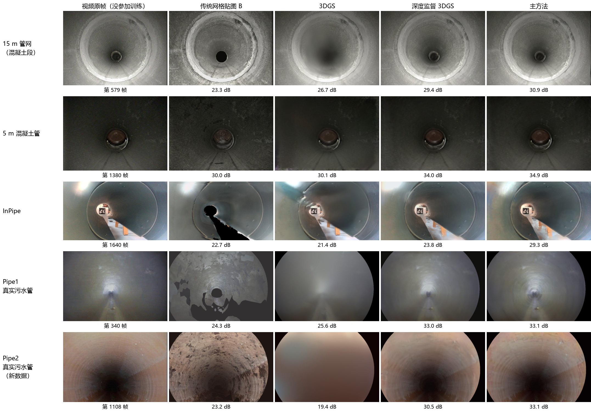

# 评测协议与结果

本文件说明模型怎样评测（协议在主实验之前写定，之后没有改过），以及主方法和各个对照、消融的结果。
数字全部取自作者的实验记录，这里汇总。
模型本身见 [MODEL.md](MODEL.md)。

---

## 1. 评分（"量尺 v2"，`train_gs.py` 训练结束时自动做；`pipesplat/rescore.py` 对已训练模型重做）

每个测试帧：
1. 模型从该帧的位姿渲染（含车灯因子和环境光；**不含**每帧增益，留出帧没有自己的增益）；
2. 四个候选——模型渲染 **G**、对照方法 **B**（OpenMVS 带贴图网格 × 画面固定的灯光图，见 `lampmap/README.md`）、
   **Nal**（视频的下一帧用 DIS 光流对齐到本帧：视频本身相邻两帧差多少的参照。它不是严格上限：模型渲染比视频平滑，可以超过它，第 4 节主方法有 4 格超过）、**D**（本帧去噪）——各自按最小二乘拟合每个颜色通道的增益 + 偏移（`imgmetrics.linear_match`）；
3. 在**同一批像素**上算指标：B 的覆盖掩码 ∩ 原画面有效区。所有模型、所有方法都在这批像素上比较。

| 指标 | 定义（`lampmap/imgmetrics.py`） |
|---|---|
| PSNR | RGB，8 位范围 |
| SSIM | 灰度，高斯窗 σ = 1.5（Wang 等 2004） |
| LPIPS | AlexNet 特征（Zhang 等 2018），掩码内平均；越低越好 |
| 错位 shift_px | 渲染与画面之间 DIS 光流（Kroeger 等 2016）在纹理处的中位长度 |
| 频段保真度 fid_fine / fid_mid / fid_coarse | 0.7–1.4、1.4–2.8、2.8–5.6 px 三个高斯差分带通的归一化互相关，除以"Nal 与本帧"同一互相关的平方根（以对齐后的下一帧为参照的比例） |
| depth_rel_err | 渲染深度相对稠密 MVS 点深度的中位相对误差（锚定模型另报相对实测管壁的） |

另一种曝光处理（NeRF-W 协议，Martin-Brualla 等 2021）：增益 + 偏移只在左半幅拟合、只在右半幅评分（`--fit-half`）；只做过试点，主表用上面的做法。

## 2. 测试组

| 测试组 | 是什么 | 帧数（15 m 管网 / 5 m 混凝土管） | 检验什么 |
|---|---|---|---|
| 序列内（held） | 训练帧之间的视频帧（插值位姿）。导出时沿全程均匀取 44 对相邻训练帧、各取中间一帧；落在整段留出段里的不计入这一组 | 42 / 42 | 贴着训练轨迹的插值 |
| 整段留出（block） | 全程 35 % 和 65 % 处两段 10 cm 内的全部帧，不参加训练 | 18 / 18 | 10 cm 内没有训练帧时的外推 |
| 跨巡检（xrun） | 同一管道另外 4 次巡检的帧，每次 60 帧，位姿来自多次巡检联合 SfM + 局部相似变换 | 240 / 240 | 换一次巡检、换一档灯光 |
| 跨巡检 + 外推（xblk） | 落在整段留出段里的其他巡检帧 | 72 / 61 | 换巡检 + 离开训练轨迹 |

另外三段数据只有前两组：InPipe 40 / 32 帧，Pipe1 44 / 11 帧，Pipe2 43 / 20 帧（序列内 / 整段留出）。
`--every 1` 抽帧的视频（每个视频帧都进了模型，如 Pipe1）没有"帧之间"的帧：改为在整段留出段之外、从注册帧里均匀取 44 帧不参加训练，用它们自己的 SfM 位姿评分。

**统计**：每个测试组取逐帧值的中位数；主表每个方法训练 3 个随机种子，报均值 ± 标准差；方法之间用逐帧配对差的中位数 + 自助法 95 % 置信区间 + Wilcoxon 符号秩检验（`pipesplat/review/paired_stats.py`；n ≤ 50 用精确分布，以上用正态近似）。
逐帧配对差的中位数不等于两个中位数之差，两者可以差很多（第 6 节有例子）；文档里"去掉某模块会怎样"的数字都是逐帧配对差的中位数。
同一配置只换种子（种子 0 对种子 1、2；深度监督 3DGS、+ 车灯、主方法；两段数据各四组，共 48 组比较），逐帧配对中位差为 0.00–0.13 dB，p 却可小到 8×10⁻¹³（15 m 管网深度监督 3DGS，跨巡检 + 外推 72 帧，+0.10 dB）：
逐帧 p 值只说明"这两个训练好的模型"不同。单种子比较要以种子间的差为尺子：主表中带几何监督的方法，3 个种子的标准差为 0.01–0.13 dB。

**多次巡检的配准**（C1 + C2）：所有巡检的帧和特征放进一次 OpenMVG 增量式 SfM（内参固定；图像对 = 每次巡检内后 25 帧 + 不同巡检间计数器相差 ≤ 8 cm 的帧，`scripts/vision/joint_sfm.py`），
再把联合重建逐帧变换到参考巡检原来的坐标（局部相似变换，`scripts/vision/align_runs.py`），然后导出测试集（`pipesplat/export_xrun.py`）。
留一法误差：15 m 管网 0.27 mm / 0.59 mrad；5 m 混凝土管 1.1 mm / 2.3 mrad（所以 5 m 管另报"测试时位姿精修后"的分数，排序不变）。

## 3. 数据

| 代号 | 数据（来源、许可） | 管道 | 本项目怎么用 |
|---|---|---|---|
| 15 m 管网 | Sheffield ORDA 15 m 混合管网（figshare 28047074，CC BY 4.0），开头两节 2.5 m 混凝土管（0–4.6 m） | 300 mm 混凝土，闭口，只有车灯照明 | 5 次巡检 r1–r5（两档灯光、两档速度、一次中途换灯光）；r1 训练，其余测试 |
| 5 m 混凝土管 | Sheffield ORDA 5 m 混凝土管（figshare 28046066，CC BY 4.0） | 300 mm 混凝土，闭口 | 5 次同一档灯光的巡检；concrete_2 训练，其余测试；concrete_1 用于标定 f、k1 |
| InPipe | InPipe-SLAM 序列 172011（Zenodo 18615583，CC BY 4.0），只用彩色相机 | 视觉管壁半径 109 / 102 mm（两节管），有开缝、管口，室内光会进来 | 单次巡检；场景文件在 Release v2.0（原始数据 10 GB） |
| Pipe1 | Sheffield 真实地下污水管（figshare 21198070，CC BY-NC-SA 4.0，Edwards 等 2023），前 10.6 m | 真实污水管，管底有水 | 单次巡检；数据集自带棋盘格标定视频和逐帧里程真值 |
| Pipe2（新数据端到端测试） | 同上数据集的 Pipe2，第 450–1500 帧（0.2–5.1 m） | 真实污水管，管壁光滑、纹理少 | 从下载到重建的整条流程检验（第 8 节） |

这些代号与视频文件、场景文件夹（如 `concrete_lab`）、训练名（如 `run_3dgs_depth_lamp_amb`）的对照见 [DATA.md](DATA.md) 第 1 节末。

---

## 4. 主表（两个多次巡检数据集，3 个随机种子，PSNR dB，均值 ± 标准差）

| 方法 | 数据 | 序列内 | 整段留出 | 跨巡检 | 跨巡检 + 外推 |
|---|---|---|---|---|---|
| OpenMVS 网格贴图 × 平场灯光图（B，种子无关） | 15 m 管网 | 25.26 | 24.42 | 25.65 | 25.72 |
| 3DGS | | 28.72 ± 0.07 | 23.97 ± 0.93 | 27.18 ± 0.09 | 24.47 ± 0.52 |
| 深度监督 3DGS | | 29.17 ± 0.02 | 28.53 ± 0.10 | 28.65 ± 0.07 | 28.65 ± 0.13 |
| 深度监督 3DGS + 车灯模型（不含环境光项） | | 30.27 ± 0.02 | **29.88 ± 0.07** | 28.62 ± 0.02 | 29.13 ± 0.04 |
| 锚定面元 + 车灯模型（不含环境光项） | | 30.18 ± 0.02 | 29.72 ± 0.12 | 28.58 ± 0.04 | 29.12 ± 0.03 |
| **主方法：深度监督 3DGS + 车灯模型 + 环境光项** | | **30.52 ± 0.05** | 29.83 ± 0.02 | **29.40 ± 0.01** | **29.48 ± 0.04** |
| 参照：对齐后的下一帧（与模型无关） | | 31.59 | 31.68 | 29.05 | 29.25 |
| OpenMVS 网格贴图 × 平场灯光图（B） | 5 m 混凝土管 | 29.84 | 29.92 | 30.22 | 29.90 |
| 3DGS | | 34.19 ± 0.14 | 29.45 ± 1.13 | 28.47 ± 0.30 | 26.40 ± 0.72 |
| 深度监督 3DGS | | 34.57 ± 0.04 | 33.77 ± 0.05 | 32.18 ± 0.07 | 31.36 ± 0.03 |
| 深度监督 3DGS + 车灯模型（不含环境光项） | | 34.59 ± 0.04 | 34.65 ± 0.08 | 33.85 ± 0.04 | 34.10 ± 0.06 |
| 锚定面元 + 车灯模型（不含环境光项） | | 34.54 ± 0.04 | 34.52 ± 0.06 | 33.84 ± 0.05 | 34.13 ± 0.08 |
| **主方法** | | **35.10 ± 0.06** | **34.91 ± 0.04** | **34.01 ± 0.02** | **34.30 ± 0.04** |
| 参照：对齐后的下一帧（与模型无关） | | 34.88 | 34.67 | 34.99 | 34.96 |

单种子另跑过的对照（种子 0）：2DGS（加数值保护）15 m 管网 28.86 / 26.49 / 27.48 / 26.40；深度监督 2DGS 29.17 / 28.42 / 28.74 / 28.45（与深度监督 3DGS 同一水平）。
主方法的 LPIPS：15 m 管网 0.436 / 0.442 / 0.627 / 0.621，5 m 混凝土管 0.431 / 0.446 / 0.468 / 0.460，八组都低于深度监督 3DGS。
渲染深度误差：有几何监督的方法 0.6–0.8 %（相对实测管壁），3DGS 21–27 %（15 m）、44–59 %（5 m）。

**逐帧配对**（3 个种子平均后的逐帧值；中位差，该方法更好的帧比例）：

| 比较 | 数据 | 序列内（42） | 整段留出（18） | 跨巡检（240） | 跨巡检 + 外推（72 / 61） |
|---|---|---|---|---|---|
| 几何监督：深度监督 3DGS − 3DGS | 15 m | +0.05（p = 0.07） | **+4.68，100 %** | +0.14，57 % | **+3.74，100 %** |
| | 5 m | −0.11（p = 0.29） | **+3.97，100 %** | +1.03，59 % | **+5.12，100 %** |
| 主方法 − 深度监督 3DGS | 15 m | **+1.22，98 %** | **+1.28，100 %** | **+0.55，93 %** | **+0.58，100 %** |
| | 5 m | +0.37，90 % | **+1.02，100 %** | **+1.22，96 %** | **+1.75，100 %** |
| 环境光项：主方法 − 不含环境光项 | 15 m | +0.24，95 % | −0.09（p = 0.13） | **+0.47，98 %** | +0.24，83 % |
| | 5 m | +0.34，100 % | +0.11，94 % | +0.05，60 % | +0.10，84 % |
| 表示方式：锚定面元 − 深度监督 3DGS（都带车灯） | 15 m | −0.10，12 % | −0.11，33 % | −0.04 | −0.03（p = 0.23） |
| | 5 m | −0.10，0 % | −0.07，0 % | −0.01 | +0.02（p = 0.57） |
| 合计：主方法 − 3DGS | 15 m | +1.34，88 % | **+5.98，100 %** | +1.28，90 % | **+4.86，100 %** |
| | 5 m | +0.20，64 % | **+4.95，100 %** | **+3.05，91 %** | **+8.11，100 %** |

表头括号里是帧数（跨巡检 + 外推：15 m 管网 72 帧、5 m 混凝土管 61 帧）。只在不显著或接近不显著时写出 p，其余各格 p ≤ 0.02。
命令：`seeds_table.py … --avg-dir DIR` 写出每个方法 3 个种子平均后的逐帧文件，再 `paired_stats.py DIR/甲_seedavg.csv DIR/乙_seedavg.csv --held-outside --pool xrun_ xblk_`。

同样的整段留出帧上各方法的画面（每段数据一帧，按“主方法比 3DGS 的提升最接近中位数”选）：

读法：离开训练轨迹时几何监督带来 3.7–5.1 dB（所有帧）；照明模型在它之上再加 0.37–1.75 dB（90–100 % 的帧，LPIPS 也更低）；几何怎么加（锚定还是深度监督）差 ≤ 0.1 dB。

## 5. 消融

**每帧曝光补偿单独**（`--exposure`，种子 0，四段数据）。下面都是逐帧配对差的中位数；Sheffield 两段与深度监督 3DGS 的 3 个种子各配对一次，给出范围：

- 只有曝光 − 深度监督 3DGS：Sheffield 序列内 / 跨巡检 −0.07…+0.05 dB；离开轨迹反而低：15 m 管网整段留出 −0.34…−0.52、跨巡检 + 外推 −0.19…−0.30，
  5 m 管整段留出 −0.11、跨巡检 + 外推 −0.04…−0.15 dB（这四组里只有 0–39 % 的帧更好）。InPipe 序列内 +0.02（p = 0.76）、整段留出 −0.48；
  Pipe1 序列内 +0.23（70 % 的帧，p = 0.002，四段数据中唯一明显更好的一组）、整段留出 −0.05（11 帧中 2 帧更好）。
- 主方法 − 只有曝光（Sheffield 用 3 个种子平均后的主方法）：Sheffield 两段四组 +0.35…+1.85 dB（83–100 % 的帧），InPipe +0.65 / +5.19，Pipe1 +1.13 / +2.64 dB
  （Pipe1 整段留出 11 帧中 8 帧更好，95 % 区间含 0）。→ 增益来自照明项，不来自每帧曝光。

**车灯模型的物理分解 V1–V5**（只在 15 m 管网 r1、种子 0 上做过，加在锚定面元上，没有在主方法上重做；序列内 / 整段留出 / 跨巡检 / 跨巡检 + 外推；展开图亮带比 = 最暗 / 最亮 60° 扇区；"响应指数"是学到的幂律相机响应的指数，不是 p 值）：

| 代号 | 改动（选项） | PSNR dB | 亮带比 | 结论 |
|---|---|---|---|---|
| 基准 | 自由 M、3 阶球谐、光源偏移可学（`--anchor --lamp --alpha-w 0.1`） | 30.19 / 29.86 / 28.61 / 29.09 | 0.39 | — |
| V1 | 0 阶球谐（`--sh-degree 0`） | 30.11 / 29.63 / 28.55 / 28.97 | 0.35 | 几乎不变；M 学到 0.00–452，光照被自由网格吸收 |
| V2 | V1 + 径向 M（`--lamp-radial 3`），光源可学 | 22.20 / 19.57 / 23.77 / 22.18 | 0.63 | 失败：光源跑到相机前方 16 cm |
| V2b | 径向 M + 同位光源（`--lamp-colocated`），不加 gamma | 22.20 / 18.85 / 23.81 / 21.20 | — | 失败：平方反比只在线性亮度上成立 |
| V3 | 径向 M + 同位 + 学习的幂律响应（`--lamp-gamma`） | 28.75 / 28.49 / 28.17 / 28.86 | 0.56 | 收敛，亮带减弱，响应指数塌到 0.19 |
| V4 | V3 + 环境光项 | 28.83 / 28.46 / 28.38 / 28.47 | — | 响应指数 0.35 |
| V5 | 径向 M + 同位 + 固定响应 0.45（BT.709，`--lamp-gamma-fixed 0.45`）+ 环境光 + Minnaert（`--lamp-minnaert`） | 29.14 / 28.65 / 28.62 / 28.74 | — | 物理版本中最好；相对基准：序列内 −1.05、整段留出 −1.21、跨巡检 +0.01、跨巡检 + 外推 −0.35 dB |

## 6. 另外两段数据（统一配置，种子 0，不按它们调任何东西）

| 方法 | InPipe 序列内 / 整段留出（40 / 32 帧） | Pipe1 序列内 / 整段留出（44 / 11 帧） |
|---|---|---|
| OpenMVS 网格贴图 × 平场灯光图（B） | 23.35 / 23.33 | 24.08 / 22.62 |
| 3DGS | 30.65 / 20.02（深度错 12 / 26 %） | 27.62 / 25.64（深度错 85 / 67 %） |
| 深度监督 3DGS | 30.48 / 23.61 | 33.87 / 32.15 |
| 深度监督 3DGS + 车灯模型（不含环境光项） | 28.08 / 23.15 | 31.63 / 30.13 |
| **主方法** | **31.60 / 28.49** | **35.88 / 35.28** |
| 参照：对齐后的下一帧（与模型无关） | 35.85 / 35.81 | 37.85 / 38.20 |

管壁用管道先验拟合的 `surface_vhf.npz`（这两段的 OpenMVS 网格有洞和飞片）。上表是各组的中位数；方法之间的比较看逐帧配对
（中位差 [自助法 95 % 区间]，前者更好的帧比例，Wilcoxon p；`paired_stats.py 甲/per_frame_r2.csv 乙/per_frame_r2.csv --held-outside`）。
配对中位差可以和"两个中位数之差"差很多：InPipe 序列内，上表主方法 31.60、3DGS 30.65（高约 1 dB），逐帧配对中位差却是 −0.23。

| 比较 | InPipe 序列内（40 帧） | InPipe 整段留出（32 帧） | Pipe1 序列内（44 帧） | Pipe1 整段留出（11 帧） |
|---|---|---|---|---|
| 几何监督：深度监督 3DGS − 3DGS | −1.26 [−1.61, −0.35]，30 %，p = 0.023 | +2.41 [+2.02, +3.55]，94 %，1×10⁻⁸ | +5.14 [+2.26, +8.19]，80 %，6×10⁻⁶ | +7.31 [+4.63, +10.65]，11 / 11，p = 0.001 |
| 车灯（不含环境光项）− 深度监督 3DGS | −1.75 [−2.17, −1.28]，5 %，3×10⁻¹¹ | −0.43 [−1.16, +0.08]，41 %，p = 0.11 | −1.63 [−3.29, −1.31]，11 %，5×10⁻⁹ | −2.91 [−6.34, −1.99]，0 / 11，p = 0.001 |
| 环境光项：主方法 − 不含环境光项 | +2.71 [+1.67, +3.80]，98 %，5×10⁻¹¹ | +5.44 [+5.18, +5.73]，100 %，5×10⁻¹⁰ | +3.75 [+2.60, +5.20]，100 %，1×10⁻¹³ | +5.17 [+4.97, +6.17]，11 / 11，p = 0.001 |
| 照明模型：主方法 − 深度监督 3DGS | +0.56 [+0.17, +1.34]，75 %，1×10⁻⁴ | +4.54 [+3.96, +5.18]，100 %，5×10⁻¹⁰ | +1.36 [+0.96, +1.68]，95 %，3×10⁻¹² | +2.59 [−0.14, +3.08]，8 / 11，p = 0.054 |
| 只有曝光 − 深度监督 3DGS | +0.02 [−0.12, +0.11]，55 %，p = 0.76 | −0.48 [−0.84, −0.31]，6 %，2×10⁻⁸ | +0.23 [+0.06, +0.56]，70 %，p = 0.0021 | −0.05 [−0.13, −0.03]，2 / 11，p = 0.019 |
| 主方法 − 只有曝光 | +0.65 [+0.14, +1.38]，75 %，1×10⁻⁵ | +5.19 [+4.60, +5.80]，100 %，5×10⁻¹⁰ | +1.13 [+0.68, +1.57]，95 %，1×10⁻¹⁰ | +2.64 [−0.15, +3.17]，8 / 11，p = 0.024 |
| 合计：主方法 − 3DGS | −0.23 [−1.19, +1.07]，45 %，p = 0.65 | +7.53 [+6.52, +8.99]，100 %，5×10⁻¹⁰ | +7.98 [+3.43, +10.60]，95 %，1×10⁻¹² | +7.90 [+4.22, +14.06]，11 / 11，p = 0.001 |

读法：
- 几何监督和照明模型（依次）在这两段上都有大幅提升：InPipe 整段留出 +2.41 / +4.54 dB；Pipe1 序列内 +5.14 / +1.36、整段留出 +7.31 / +2.59 dB（最后一个不显著，见最后一条）。
- 环境光项是决定性的：不带它的车灯模型比没有车灯还差（4 组中 3 组显著，InPipe 整段留出不显著），带上后反转。这两段里有大量不来自车灯的光（InPipe 的开缝和管口、Pipe1 管底的水面反光）。
- 例外：InPipe 序列内，3DGS 反而比深度监督 3DGS 好（深度监督 3DGS − 3DGS = −1.26，70 % 的帧上深度监督 3DGS 更差），主方法与 3DGS 持平（−0.23，p = 0.65）。贴着轨迹时，几何监督在 InPipe 上没有帮助。
- Pipe1 整段留出只有 11 帧：主方法 − 深度监督 3DGS 的 95 % 区间含 0（p = 0.054），不算显著；主方法 − 只有曝光 p = 0.024，但区间含 0，算弱证据。

## 7. 多次巡检联合训练、展开图、几何

- **联合训练（D1）**：15 m 管网 r1 + r2（两档灯光）一起训练，在从未用过的 r3–r5 上跨巡检 +0.35、跨巡检 + 外推 +0.42 dB；帧数相同的对照（388 帧 < r1 单独的 430 帧）仍 +0.36 / +0.24 dB，
  对 r1 的 3 个种子都是 +0.24…+0.42 dB。同一档灯光的第二次巡检只有其 25–60 %；5 m 混凝土管（5 次同一档灯光）帧数相同的对照 0.00、全帧 −0.2…−0.3 dB（加倍迭代后持平）。
  结论：巡检之间灯光不同时有益。（这组实验用锚定面元 + 车灯模型。）
- **展开图可重复性（D2）**：15 m 管网 r1–r4 各自训练，展开图纹理 NCC 0.62–0.73；带车灯模型 0.657、不带 0.596，6 对全部更高。
- **几何可重复性（D3）**：5 m 混凝土管 5 次独立重建，各次管径中位数 305–315 mm（均值 309.6、标准差 4.6 mm；标称 300），逐截面 s_r 8.2 mm，椭圆度中位 0.32–0.41 %（s_r 0.25 个百分点）；
  1.87 m 处管壁亮带的沿管位置在 5 次之间的标准差约 2 cm（1.6–1.9 cm，取决于截面亮度峰值的插值方法）。管径绝对值依赖按计数器标定的焦距，不是独立测量；独立参照只有 InPipe（RealSense 深度 107.5 / 101.4 mm 对视觉管壁 109.4 / 101.9 mm）。

## 8. 新数据端到端测试：Pipe2（2026-11-02）

从下载到重建全部用 `scripts/download_data.py` + `scripts/vision/calibrate_checkerboard.py` + `scripts/pipeline.py` 完成，命令和用时见 [PIPELINE.md](PIPELINE.md) 第 4 节。

同一场景、同样设置（3 万次迭代、种子 0、管壁 `surface_vhf.npz`），没参加训练的帧：

| 方法 | 序列内留出（43 帧） | 整段留出（20 帧） | LPIPS | 错位 px | 渲染深度误差 |
|---|---|---|---|---|---|
| 对照 B：OpenMVS 网格贴图 × 平场灯光图 | 22.74 | 22.58 | 0.539 / 0.554 | 8.8 / 11.9 | — |
| 3DGS | 26.91 | 19.36 | 0.556 / 0.609 | 23.1 / 48.4 | 91 % / 88 % |
| 深度监督 3DGS | 36.30 | 32.40 | 0.367 / 0.424 | 2.1 / 1.9 | 1.3 % / 2.0 % |
| **主方法** | **36.59** | **34.35** | **0.333 / 0.362** | 2.1 / 1.2 | 1.2 % / 1.3 % |
| 主方法烘焙的带纹理网格 | 33.69 | 32.55 | 0.342 / 0.389 | 2.4 / 1.8 | — |
| 参照：对齐后的下一帧（与模型无关） | 38.17 | 38.22 | 0.129 / 0.128 | 0.2 / 0.2 | — |

逐帧配对（中位差 [自助法 95 % CI]，前者更好的帧比例，Wilcoxon p；`paired_stats.py … --held-outside`）：

| 比较 | 序列内留出（43 帧） | 整段留出（20 帧） |
|---|---|---|
| 几何监督：深度监督 3DGS − 3DGS | +9.35 [+7.72, +11.82]，100 %，2×10⁻¹³ | +12.69 [+10.98, +13.05]，100 %，2×10⁻⁶ |
| 照明模型：主方法 − 深度监督 3DGS | +0.23 [+0.02, +0.50]，67 %，p = 0.12 | **+1.83 [+1.53, +2.15]，100 %，2×10⁻⁶** |
| 同上，LPIPS（越低越好） | −0.044 [−0.047, −0.037]，86 %，1×10⁻⁷ | −0.058 [−0.062, −0.051]，100 %，2×10⁻⁶ |
| 合计：主方法 − 3DGS | +8.53 [+7.78, +11.57]，100 %，2×10⁻¹³ | +14.66 [+13.15, +15.33]，100 %，2×10⁻⁶ |

序列内的照明模型一行：中位差的自助法区间刚好不含 0，而 Wilcoxon 检验（用全部差值的秩，检验差值是否以 0 为中心对称）不显著；两者不一致，只算弱证据，按"持平"读。
这段视频的 SfM 只注册了 413 / 526 帧（78.5 %，低于 PIPELINE.md 2.5 节说的正常值 90 %），重建的是真值 1.0–5.1 m 这一段；开头 0.2–1.0 m 没有接上，既不在模型里，也没有测试帧。

读法：在一段从未参与任何决定的新管道上，结论与四段已有数据相同——没有几何监督的 3DGS 离开训练视角就崩（深度错约 90 %、错位几十像素），
几何监督是决定性的；照明模型在它之上离开轨迹时再加 1.8 dB（全部帧），贴着轨迹时持平，LPIPS 两组都更低。
这段视频的单目尺度沿程漂移约 31 %（真值检验），模型从管外看是喇叭形，管径不能直接当测量值（PIPELINE.md 第 4 节）。

## 9. 怎样复现这些数字

- 已训练模型重新评分：`pipesplat/rescore.py DATA/RUN ...`（按模型自己的选项，打印新旧对比）。
- 三种子主表：`pipesplat/review/seeds_table.py`；逐帧配对：`pipesplat/review/paired_stats.py`；多组测试的表：`pipesplat/review/table_x5.py`；跨巡检评分：`pipesplat/review/score_xrun.py`。
- 每个模型的训练选项：[PIPELINE.md](PIPELINE.md) 第 5 节的表；多次巡检测试集的做法：同一文件第 6 节。

**可复核性**：公开的是全部代码、本文件和其他文档，以及 README 的图（每张图的来源和生成脚本见 [images/SOURCES.md](images/SOURCES.md)）。
没有公开的：训练好的模型、场景文件（带图像，每段 0.4–1 GB）和每次评分的逐帧表（`per_frame_r2.csv`、`summary_r2.json`）。所以本文件的表目前只能按 PIPELINE.md 重新导出场景、重新训练后复核：
重新训练的模型与记录不逐位相同（GPU 上的求和顺序不固定），差别预计在种子间差的量级，但没有专门测过。早期结果的 Release `v2.1-results` 上传未完成（缺 8 个分卷）。
