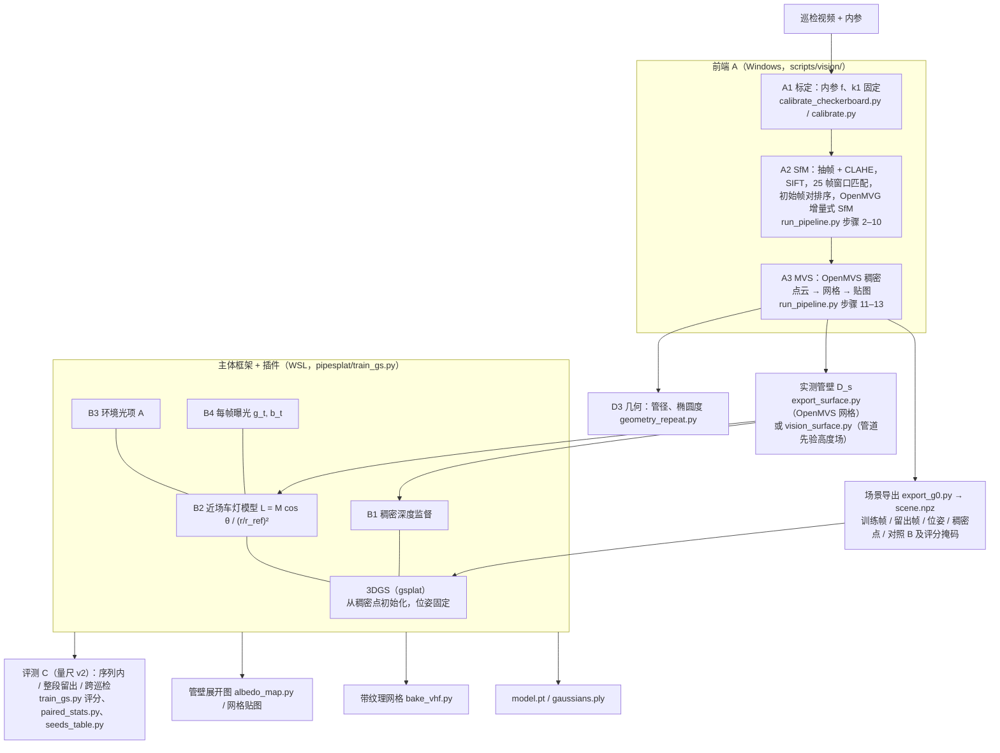

# 三维重建模型说明（主方法）

本文件完整描述 PipeRecon3D 现在使用的三维重建模型：输入输出、每个模块、公式、超参数、对应的代码位置，以及每个模块"为什么在这里、去掉会怎样"。
实验数字汇总在 [EVALUATION.md](EVALUATION.md)，这里只引用。
运行步骤见 [PIPELINE.md](PIPELINE.md)，文件格式见 [DATA.md](DATA.md)，想改模型从 [EXTENDING.md](EXTENDING.md) 开始。

---

## 0. 一句话

一次管道 CCTV 巡检的前视单目视频（机器人沿管轴前进，灯装在相机旁边），
先用 **SfM + MVS**（OpenMVG 1.6 + OpenMVS 2.4.0，内参事先标定并固定）得到相机位姿和实测管壁，
再训练一个 **3D 高斯泼溅（3DGS）** 模型，并在 3DGS 上加两个可插拔模块：
**稠密深度监督**（让几何对）和**近场照明模型**（车灯的平方反比 + Lambert 余弦 + 平场增益图 + 环境光项 + 每帧曝光补偿，让明暗对）。
这样模型离开训练轨迹、换一次巡检、换一档灯光时仍能预测画面。

| | 内容 |
|---|---|
| 输入 | 一段管道视频；相机内参（棋盘格标定，或"等径直管 + 一段已知行程"标定）；可选：画面计数器 / 里程真值、管径 |
| 输出 | 高斯模型 `model.pt`（任意位姿实时渲染）和通用 3DGS `.ply`；带纹理网格 OBJ（从管外看）；管壁展开图；管径 / 椭圆度沿程；每帧评分 |
| 代码 | 前端 `scripts/vision/`（Windows）；高斯部分 `pipesplat/`（WSL + CUDA）；一条命令跑完：`scripts/pipeline.py` |
| 主方法的训练命令 | `train_gs.py SCENE OUT --baseline 3dgs --baseline-depth 1.0 --lamp --lamp-smooth-mm 20 --lamp-ambient` |

---

## 1. 总体结构



**层次与依赖**：

| 代号 | 模块 | 层 | 依赖 | 代码 |
|---|---|---|---|---|
| A1 | 相机标定（内参固定） | 前端 | 独立；换相机必须重做 | `scripts/vision/calibrate_checkerboard.py`、`calibrate.py` |
| A2 | SfM（OpenMVG 增量式） | 前端 | A1 | `scripts/vision/run_pipeline.py` 步骤 1–10 |
| A3 | MVS 实测管壁（OpenMVS；纹理少时用管道先验拟合） | 前端 | A1、A2 | 步骤 11–13；`pipesplat/export_surface.py`、`vision_surface.py` |
| — | 主体框架：3D 高斯泼溅 | 模型 | A2 的位姿、A3 的稠密点 | `pipesplat/train_gs.py --baseline 3dgs` |
| B1 | 稠密深度监督 | 训练插件（损失项） | A3 的 D_s；与表示方式无关 | `--baseline-depth 1.0` |
| B2 | 近场车灯模型 | 训练插件（成像模型） | A3（算 r、θ）；代码要求同时有 B1 或 `--anchor` | `--lamp` |
| B3 | 环境光项 | B2 的子项 | B2 | `--lamp-ambient` |
| B4 | 每帧曝光补偿 | 成像模型 | 主方法里随 B2 一起；也能单独用 | `--lamp` 自带；单独：`--exposure` |
| B1′ | 锚定面元（另一种几何约束，只在消融里） | 训练插件 | A3 | `--anchor` |
| C1–C4 | 评测：多次巡检联合 SfM、局部相似变换、测试时位姿精修、评分与统计 | 评测 | 与模型无关 | `joint_sfm.py`、`align_runs.py`、`export_xrun.py`、`train_gs.py` 评分、`review/paired_stats.py`、`seeds_table.py` |
| D1 | 多次巡检联合训练 | 训练数据的用法 | C1、C2 | `pipesplat/export_multi.py` |
| D2 | 管壁展开图 | 下游 | 训练好的模型 | `pipesplat/albedo_map.py`；网格贴图 `bake_vhf.py` |
| D3 | 几何测量（管径、椭圆度、沿管位置） | 下游 | 只用 A2、A3，不经过高斯模型 | `scripts/analysis/geometry_repeat.py` |

真正独立的只有三样：主体框架、B1（与表示方式无关）、C 整组（与模型无关）。B2–B4 是一组，必须用在 B1（或锚定）之上。

---

## 2. 成像模型与损失（主方法）

```
损失      ℒ = 0.8 · L1(Î_t, I_t) + 0.2 · (1 − SSIM(Î_t, I_t)) + 1.0 · mean_u |D̂(u) − D_s(u)| / D_s(u)
成像      Î_t(u) = g_t ⊙ [ L_t(u) · Ĉ(u) + Â(u) ] + b_t
车灯因子  L_t(u) = M(u) · cos θ_t(u) / (r_t(u) / r_ref)²
```

| 符号 | 含义 | 来自 / 代码 |
|---|---|---|
| I_t | 第 t 个训练帧（原始视频帧，未做 CLAHE；去畸变到针孔画布） | `scene.npz` 的 `train_images`；`canvas()` |
| Ĉ(u)、D̂(u) | 3DGS 渲染的颜色（3 阶球谐）和期望深度 | `rasterize()`，`render_mode="RGB+ED"` |
| D_s(u) | 实测管壁在该视角下的深度：管壁每个三角形渲染成一个不透明薄圆片 | `surface_depth()`；训练前对每个训练帧算好（`DA`） |
| L_t(u) | 车灯在像素 u 处的照度因子 | `lamp_factor()` = `lamp_map()` × `lamp_geometry()` |
| M(u) | 相机固定的平场增益图（镜头渐晕 × 灯的辐射分布），48 × 36 网格，双线性插值到画布 | `lamp["logM"]`（对数） |
| r_t、θ_t | 管壁点到光源的距离、入射角；由 D_s 和约 20 mm 平滑后的管壁法向算出；光源相对相机的偏移 `lamp["t"]` 可学，从 0 开始 | `lamp_geometry()`、`smooth_normals()`；cos 下限 0.05 |
| r_ref | 训练帧上实测深度的中位数（只为数值尺度） | 训练前算好 |
| Â(u) | 环境光：每个高斯一个与视角无关、不被车灯缩放的颜色（sigmoid，起始约 0.01），按高斯渲染 | `params["amb"]`、`ambient()` |
| g_t、b_t | 第 t 帧每个颜色通道的增益（exp(log 增益)）和偏移 | `lamp["gain"]`、`lamp["off"]` |

**训练时**：每次迭代随机取一个训练帧，按上式渲染 Î_t，算 L1 + SSIM（只在有效画布内）+ 深度项（只在 D_s > 0 的像素）。
**评分时**（留出帧没有自己的 g_t、b_t）：渲染 L·Ĉ + Â，再在评分像素上按最小二乘拟合这一帧的每通道增益 + 偏移（与所有对照方法完全相同的处理，见 [EVALUATION.md](EVALUATION.md)）。

**M 的起始值**：让 M·cos θ/(r/r_ref)² 在每个像素上的平均值为 1（对每 8 个训练帧的几何因子取对数平均，再池化到 48 × 36），所以第一次渲染与不加灯光模型时相同。

---

## 3. 主体框架：3D 高斯泼溅

3D Gaussian Splatting（Kerbl 等，ACM TOG 2023），实现用 gsplat 1.6.0（commit `512d366`）。

| 项 | 设置 | 代码 |
|---|---|---|
| 表示 | 每个高斯：位置、尺度（3 个，log）、旋转（四元数）、不透明度（logit）、3 阶球谐颜色（sh0 + 15 × 3 个 shN）；主方法另有环境光颜色 `amb` | `params` |
| 初始化 | OpenMVS 稠密点（比原论文的稀疏 SfM 点强），只保留被某个训练帧看到的点；颜色取最近看到它的训练帧的像素；尺度 = 到最近 3 个点的均方根距离；不透明度 0.1；单位旋转 | "Gaussians" 一节 |
| 渲染 | gsplat 可微分块光栅化，逐像素按深度 α 混合，同时得到颜色和期望深度（`RGB+ED`）；近平面 0.01 m | `rasterize()` |
| 相机 | 单焦距 + 一个径向畸变 k1（OpenMVG "pinhole radial 1"）；训练在**去畸变的针孔画布**上进行，画布比原画面大，装得下整幅原画面（k1 折返半径的 95 % 以内） | "camera canvas" 一节 |
| 位姿 | 取 A2 的 SfM 位姿，训练中不动 | `scene.npz` 的 `train_viewmats` |
| 优化 | Adam，30 000 次迭代，每次一帧；位置学习率 1.6e-4 × 场景尺度，按原版 3DGS 指数衰减到 1 %；尺度 5e-3、旋转 1e-3、不透明度 5e-2、sh0 2.5e-3、shN 1.25e-4、环境光 5e-3；M 3e-3、光源偏移 1e-4、增益 1e-3、偏移 1e-4 | `lrs`、`optimizers` |
| 密度控制 | gsplat DefaultStrategy（克隆、分裂、剪枝），第 15 000 次迭代后停止；球谐阶数每 1000 次迭代升一阶，到 3 阶 | `strategy` |
| 留出 | 两段 10 cm 的整段留出帧不参加训练（`block_idx`） | `train` |
| 数值保护 | 非有限的损失跳过这一步，非有限的梯度置零，并计数写进日志 | 训练循环 |
| 资源 | RTX 5060 Ti（8 GB）上每个模型 30–80 分钟，显存峰值 ≤ 约 4.5 GB；稠密点 > 2.5 M 时用 `--points-every 2` | — |

**只用主体框架会怎样**（3 个种子，PSNR dB；四组测试的定义见 [EVALUATION.md](EVALUATION.md)）：

| 测试组 | 15 m 管网 | 5 m 混凝土管 |
|---|---|---|
| 序列内（插值位姿） | 28.72 ± 0.07 | 34.19 ± 0.14 |
| 整段留出（10 cm 内没有训练帧） | 23.97 ± 0.93 | 29.45 ± 1.13 |
| 跨巡检 | 27.18 ± 0.09 | 28.47 ± 0.30 |
| 跨巡检 + 外推 | 24.47 ± 0.52 | 26.40 ± 0.72 |

渲染深度错 21–27 %（15 m）、44–59 %（5 m）、InPipe 12 / 26 %、Pipe1 85 / 67 %（管内浮着一层"雾"）。
贴着训练轨迹时画面很好，一离开轨迹就崩：相机只沿管轴前进，新视角只在训练轨迹附近受约束。

**为什么用 3DGS 作主体**：高斯是显式的点，能直接从 MVS 点初始化、直接加深度监督和成像模型；训练 30–80 分钟、实时渲染；最常用的基线。
插件与表示方式无关：锚定面元与 3DGS 只差约 0.1 dB，深度监督 2DGS 与深度监督 3DGS 同一水平，所以换主体框架不改变结论。

---

## 4. 前端模块 A1–A3

### A1 相机标定（内参固定，SfM 中不优化）

- **做什么**：标定焦距 f 和径向畸变 k1（OpenMVG 的单焦距 + 一个 k1 模型），SfM 里固定。
  - 有棋盘格视频：`calibrate_checkerboard.py`（Zhang 2000）。两遍：先放开 fx、fy 测像素宽高比，若偏离 1 超过 0.5 % 就把画面横向拉伸（`--stretch-x`），再在方形像素上标定。
    例：Sheffield 真实污水管的相机 f ≈ 490–495 px、k1 ≈ −0.25、拉伸 1.0155–1.0159（同一棋盘格视频两次标定差约 1 %）。
  - 没有棋盘格：`calibrate.py`，先扫 k1 让管径沿程不变，再调 f 让行程等于计数器。Sheffield Minicam：f = 806 px、k1 = −0.33（768 × 548 的帧）。
- **为什么**：相机只沿光轴前进时，图像里几乎没有能确定焦距的信息；焦距错只会把模型沿管轴拉伸，重投影误差照样很小。
- **去掉会怎样**：猜 f = 740、不建模畸变 → 锥形管（首尾管径比 0.55）、行程 −18.6 %；让 OpenMVG 优化焦距 → 14 组参数里放开内参的 9 组只注册 0–10 帧；
  COLMAP 默认自标定 → 焦距估成 1186 px、管轴拉长 +41.9 %，实验室管只注册 13 / 451 帧。
- **局限**：单目沿管轴只能确定"焦距 × 管径"，按计数器或标称管径定尺度后的管径不是独立的绝对测量。
- **核实工具**：`scripts/analysis/focal_check_rotation.py`（视频里有云台转动、机器人不动的一段时直接测 f）、`focal_check_rings.py`（用真值里程测 f × 管半径）。

### A2 SfM（`run_pipeline.py` 步骤 1–10）

| 步骤 | 做什么 | 关键设置 |
|---|---|---|
| 2 | 抽帧（`extract_frames.py`）+ CLAHE | `--every N` 让相邻帧约 1 cm；`--crop` 裁掉烧录文字（否则静止的文字成了"不动的特征点"）；Sheffield 视频自动做 PAL 拉伸和裁边 |
| 3 | 建图像列表，写入已知内参和 k1（`set_distortion.py`） | 内参固定 |
| 4 | SIFT 特征 | ULTRA 预设 |
| 5 | 匹配 + 几何校验 | 每帧与后 25 帧匹配（`-v 25`），基础矩阵 RANSAC |
| 7 | 初始帧对排序（`pick_pair.py`） | 相隔 ≥ 6 帧、≥ 60 个匹配（低纹理管 `--loose`：40 个）、恢复出的运动以前进为主；按 2° 以上视差的匹配数排序 |
| 8 | OpenMVG 增量式 SfM | 依次尝试候选帧对，注册率 < 90 % 时继续，保留注册最多的一次 |
| 9–10 | 上色；删除落在相机背后的退化点（`clean_sfm.py`）；转 OpenMVS 并修正主点（`fix_mvs_k.py`：OpenMVG 1.6 → OpenMVS 2.4.0 主点差半幅图像） | — |

- **为什么这样设**：帧间视差小（每帧约 1 cm），SfM 难初始化；OpenMVG 自选的初始帧对常落在平面端盖上而失败。
  改回默认（2 帧/秒 + 10 帧窗口）只注册 93 / 199 帧；让 OpenMVG 自选初始帧对只注册 2 帧。
- **效果**：4 段独立检验视频行程误差 −0.6…−5.0 %（平均 −2.7 %）；定位误差实验室管 0.37 %、Pipe1 0.83 %。
- **断开时**：`--part`、`merge_parts.py` 分段重建再按管轴拼接（15 m 管网在接口 / 检查井处断成 4 段）。

### A3 MVS 实测管壁（步骤 11–13 + 管壁导出）

- **OpenMVS**：DensifyPointCloud（`Densify.ini` 放宽三处）→ ReconstructMesh → TextureMesh（关闭接缝匀色：在这类视频上它会把 57–98 % 的面变黑）。
  concrete_2 上 193 万点、92 % 在管壁 ±15 % 以内、整圈覆盖；COLMAP PatchMatch 只有 68 万点、62 %。
- **管壁给训练用的形式**（两种，`--surface` 选择）：
  - `surface.npz`（`export_surface.py`）：OpenMVS 网格的每个带贴图三角形（中心、法向、大小），在管道坐标里。两段 Sheffield 数据用它。
  - `surface_vhf.npz`（`vision_surface.py`）：管壁纹理少、网格有洞和飞片时（深色光滑管、有水的真实污水管），用"视觉稠密点 + 管道先验"拟合高度场 r(u, θ)：
    每 1 cm 一个截面，鲁棒最小二乘拟合 r(θ) = R + a cos θ + b sin θ + c cos 2θ + d sin 2θ，中心线按平行移动构造，再叠加一层平滑的细节（接缝、凹坑）。
    OpenMVS 网格里落在拟合管道之外的三角形（管口以外等）也并进来，所以要先有 `surface.npz`。InPipe 拟合出的半径 109.4 / 101.9 mm，与 RealSense 立体深度 107.5 / 101.4 mm 一致。InPipe、Pipe1 用它。同时写出 `mesh_vhf.npz`、`centerline_vhf.npz`（烘焙网格用）。
- **它给谁用**：B1 的实测深度 D_s，B2 的距离和入射角，D3 的管径，烘焙网格的几何。
- **注意**：渲染深度误差 0.6–0.8 % 是相对实测管壁量的，而模型就是被它监督的，所以不能当作几何精度报告。独立参照只有 InPipe 的 RealSense 深度。

### 管道坐标和尺度

`render_views.load_model` / `evaluate.pipe_frame`：拟合管轴，x = 沿管轴（米），截面上 "上" = 相机平均的画面上方向；
尺度 = 管径设为 `PIPE3D_PIPE_DIAMETER_M`（默认 0.30 m）时的尺度；有 `counter.csv`（计数器 / 里程真值）时 x 的原点与计数器对齐。
场景、管壁、训练好的模型都在这个坐标系里。

---

## 5. 插件模块 B1–B4

### B1 稠密深度监督（`--baseline-depth 1.0`）

- **做什么**：每个像素上渲染深度与实测深度的相对 L1，权重 1.0，覆盖 D_s 有值的全部像素。
- **解决什么**：前进运动下，3DGS 会用"管内的雾"和错位的颜色去拟合训练帧（渲染深度错 12–85 %）；深度监督把高斯压回管壁上。
- **去掉会怎样**（深度监督 3DGS − 3DGS，3 个种子平均后的逐帧配对）：15 m 管网整段留出 / 跨巡检 + 外推 −4.68 / −3.74 dB，5 m 混凝土管 −3.97 / −5.12 dB（100 % 的帧）；
  InPipe 整段留出 −2.41 dB；Pipe1 序列内 / 整段留出 −5.14 / −7.31 dB。贴着轨迹的跨巡检帧只差 0.1 / 1.0 dB。
- **结论**：离开训练轨迹时"有没有几何监督"决定成败，"几何怎么加"（锚定面元还是深度监督）是次要的。这是全部结论里最强的一条。

### B1′ 锚定面元（`--anchor`，只在消融里）

把高斯压成贴在实测管壁上的薄圆片（Gaussian surfels，Dai 等 2024 的思路）：起始点吸附到最近的管壁三角形（> 10 mm 的丢掉），法向 = 实测法向、厚度 ≤ 0.05 mm，
中心沿法向只能移动 ±2 mm，不做密度控制。与深度监督 3DGS 相比序列内 / 整段留出低约 0.1 dB、跨巡检相同，所以主方法不用它。
好处是高斯就在管壁 ±2 mm 内，便于展开图和网格贴图（D2 的可重复性实验用的就是它）。`--alpha-w 0.1` 是配合它的覆盖项（管壁不透明）。

### B2 近场车灯模型（`--lamp --lamp-smooth-mm 20`）

- **做什么**：渲染颜色乘车灯照度因子 L = M · cos θ / (r/r_ref)²（平方反比定律 + Lambert 余弦定律；r、θ 来自实测管壁；光源偏移可学；M 是 48 × 36 的自由平场增益图）。
- **解决什么**：管道里主要的光源是装在相机上的灯，同一块管壁离相机越近越亮。没有它时，3DGS 只能用随视角变化的球谐颜色去"记住"每个距离下的亮度，离开轨迹或换一档灯光就错。
  车灯因子把"距离造成的明暗"从管壁颜色里拿了出来。
- **去掉 B2–B4 会怎样**（主方法 − 深度监督 3DGS 的反号；序列内 / 整段留出 / 跨巡检 / 跨巡检 + 外推）：15 m 管网 −1.22 / −1.28 / −0.55 / −0.58 dB，
  5 m 混凝土管 −0.37 / −1.02 / −1.22 / −1.75 dB（90–100 % 的帧，LPIPS 八组都更差）；InPipe −0.56 / −4.54 dB，Pipe1 −1.36 / −2.59 dB。
- **可辨识性**（为什么用自由 M）：直管里相机相对管壁的位姿几乎不变，画面中每个方向只看到管壁的一个方位角，所以自由 M 和"管壁沿圆周的反照率"只差一个随方位角变化的因子，不可分
  （展开图里管底留着一条亮带，亮带比约 0.4）。改成径向对称渐晕（Goldman 2010，`--lamp-radial 3`）+ 光源与相机同位（`--lamp-colocated`）后可分，
  但必须同时建模幂律相机响应（gamma，`--lamp-gamma` / `--lamp-gamma-fixed 0.45`），否则两次都不收敛；最完整的物理版本 V5 跨巡检与自由 M 持平、序列内低约 1 dB。
  所以主方法保留自由 M，物理版本作为可辨识性分析（[EVALUATION.md](EVALUATION.md) 第 5 节 V1–V5）。

### B3 环境光项（`--lamp-ambient`）

- **做什么**：每个高斯再加一个与视角无关、不被车灯因子缩放的颜色 Â（Phong 1975 反射模型中的环境光项）。
- **解决什么**：不是所有的光都来自车灯。InPipe 有从开缝和管口进来的室内光，Pipe1 管底是反光的水面，闭口管里还有管壁之间的多次反射。只有"车灯 × 反照率"时，这部分光没有地方放。
- **去掉会怎样**（主方法 − 不含环境光项的反号）：InPipe −2.71 / −5.44 dB，Pipe1 −3.75 / −5.17 dB；不带环境光项的车灯模型在这两段上反而比没有车灯模型还差 1.6–2.9 dB。
  Sheffield（3 个种子）：15 m 管网 −0.24 / +0.09（不显著）/ −0.47 / −0.24 dB，5 m 混凝土管 −0.05…−0.34 dB。代价：15 m 管网 LPIPS 略高 0.005–0.015。
- **如实说明**：带不带环境光项是在测试集上做的二选一，取舍规则在结果出来之前写定。

### B4 每帧曝光补偿（`--lamp` 自带；单独用 `--exposure`）

- **做什么**：每帧、每个颜色通道一个增益 g_t 和偏移 b_t，与模型一起学。
- **解决什么**：灯光档位、相机增益、模拟视频的电平起伏，让同一块管壁在不同帧里整体亮度不同。
- **单独消融**（`--exposure`：只加 g_t、b_t，不乘车灯因子；四段数据种子 0）：序列内和跨巡检与深度监督 3DGS 持平（−0.07…+0.05 dB），离开轨迹反而低 0.04–0.52 dB；
  在它之上，照明项（B2 + B3）每组都更好（Sheffield +0.35…+1.85 dB，InPipe +0.65 / +5.19，Pipe1 +1.13 / +2.64）。
  **增益来自近场照明本身，不来自每帧曝光。** 没有车灯因子时，闭口管上学到的每帧增益离散是主方法的 2–3 倍（增益在吸收车灯造成的明暗变化）。
- 主方法里去掉 B4 的反向消融没有做。

---

## 6. 评测 C1–C4（与模型无关；细节见 EVALUATION.md）

- **C4 评分（"量尺 v2"）**：每个测试帧上，模型渲染、对照 B、对齐后的下一帧（Nal，视频噪声决定的上限）、去噪后的本帧（D）各自拟合每通道增益 + 偏移，
  然后在**同一批像素**（B 的掩码）上算 PSNR、SSIM、LPIPS、DIS 光流错位、三个频段的保真度、渲染深度误差。测试组：序列内留出帧、整段留出帧（两段 10 cm）、跨巡检帧。
- **C1 多次巡检联合 SfM**（`joint_sfm.py`）+ **C2 局部相似变换**（`align_runs.py`，每帧用周围参考相机按高斯权重 σ = 0.10 m 拟合：旋转 = 相机朝向的正交 Procrustes，尺度和平移 = 相机中心最小二乘）
  把其他巡检的帧放进参考重建：留一法误差 15 m 管网 0.27 mm / 0.59 mrad，5 m 混凝土管 1.1 mm / 2.3 mrad。
- **C3 测试时位姿精修**（`--test-pose-iters 3`）：模型冻结，用光流精修测试帧位姿后再评分，只作检验，不进主表。
- **统计**：3 个随机种子的均值 ± 标准差；逐帧配对的中位差 + 自助法 95 % 置信区间 + Wilcoxon 符号秩检验。
  同一配置只换种子，逐帧配对也能 p < 10⁻¹⁵，所以单种子比较要以种子间差（0.01–0.14 dB）为尺子。

---

## 7. 下游输出 D1–D3

| 输出 | 做法 | 代码 | 结果 |
|---|---|---|---|
| 通用 3DGS `.ply` | INRIA 布局（位置、法向、f_dc、f_rest、opacity、scale、rot），SuperSplat 等查看器可直接打开；车灯因子、环境光、每帧曝光不在 .ply 里（看到的是均匀光照下的颜色） | `pipesplat/export_ply.py` | — |
| 带纹理网格 OBJ | 管壁高度场网格（再按模型深度径向微调 ±5 mm）；每个纹素在最清楚的几帧里按"帧 = 增益 × (车灯因子 × 反照率 + 环境光) + 偏移"做最小二乘求反照率；`texture.png` = 典型车灯 × 反照率 + 环境光 | `pipesplat/bake_vhf.py --two-light --source video` | 比高斯模型低 5–10 dB（静态贴图装不下随相机走的车灯明暗）；从管外看用它，管内画质以高斯模型为准 |
| 管壁展开图 D2 | 训练位姿渲染模型的 0 阶颜色（不乘车灯、不加曝光），在 1 mm 网格上多视角加权烘焙 | `pipesplat/albedo_map.py`、`review/albedo_compare.py` | 15 m 管网 4 次巡检各自训练，纹理 NCC 0.62–0.73，带车灯模型的 6 对全部更高 |
| 效果图 | 整体、三视图、剖切、展开图、留出帧对照 | `pipesplat/review/pipe_figures.py` | `scripts/pipeline.py` 的 figures 阶段 |
| 几何 D3 | 每 5 cm 截面鲁棒圆拟合管径；圆内点再做 Fitzgibbon 直接最小二乘椭圆，椭圆度按 ASTM F1216 附录 X1；重复性按 ISO 5725 | `scripts/analysis/geometry_repeat.py` | 5 m 管 5 次独立重建：管径 309.6 ± 4.6 mm（标称 300），逐截面 s_r 8.2 mm，椭圆度 0.3–0.4 % |
| 多次巡检联合训练 D1 | 参考巡检之外再加一次巡检的帧一起训练 | `pipesplat/export_multi.py` | 巡检之间灯光不同时有益：15 m 管网在从未用过的巡检上 +0.36 / +0.24 dB（帧数相同的对照）；同档灯光只有其 25–60 %，5 m 管（同档灯光）为 0 |

---

## 8. 已知局限

1. **低纹理管道**：特征法 SfM 依赖管壁纹理。光滑、深色的管壁每对帧只有几十个可验证匹配，SfM 可能断开或无法起步（`--loose` 能救一部分，见 PIPELINE.md 的 Pipe2 例子）。
2. **管底的水和沉积物**：水面在动、会反光，MVS 在管底没有一致的深度（Pipe1 下半周只覆盖 58 %）；管道先验的高度场能补出管壁，但水面本身不在模型里。
3. **尺度**：单目没有绝对尺度；管径的绝对值依赖标定（焦距 × 管径）；单目尺度沿程有起伏（Pipe1 ±15 %，按计数器分段定尺度可减半）。
4. **外推范围**：只沿管轴前进，跨巡检的相机横向只差 2–9 mm，"外推"仍在厘米级以内。
5. **灯光模型的取舍**：自由 M 分数高但反照率的圆周分布不可辨识；物理版本（径向渐晕）可辨识但低约 1 dB。
6. **LPIPS 在模拟（PAL）视频上主要在比噪声颗粒**，读它要结合 PSNR 和频段保真度。
7. **几何精度没有独立真值**（只有 InPipe 的 RealSense 深度作参照）；渲染深度误差是相对实测管壁的，不能当精度报告。
8. **网格交付物**比高斯模型低 5–10 dB；高斯模型从管外看是飞点和针状高斯（只从管内训练过）。

---

## 9. `train_gs.py` 代码地图（改模型时从这里找）

| 位置（按文件顺序） | 内容 |
|---|---|
| 文件开头的说明 | 主方法命令、公式、全部选项的分组说明 |
| 参数与断言 | 选项之间的依赖（`--lamp` 需要 `--anchor` 或 `--baseline-depth`；`--exposure` 不与 `--lamp` 同用……） |
| camera canvas | 去畸变针孔画布（`undistort_grid`、`to_canvas` / `to_raw`、`VALID`），`project()` |
| frames, depth | 训练帧（去掉整段留出帧和 `train_drop`）、`depth_map()`（稠密点深度，评分用）、`surface_depth()` + `DA`（实测深度 D_s） |
| `if a.lamp:` | 车灯模型的全部参数（`lamp` ParameterDict）、`response()`、`smooth_normals()`、`surface_dn()`、`lamp_geometry()`、`lamp_map()`、`lamp_factor()`、M 的起始值 |
| `if a.exposure:` | 单独的每帧曝光（`expo`） |
| Gaussians | 起始点（锚定时吸附到管壁）、起始颜色、尺度、`params`、学习率 `lrs`、优化器、`DefaultStrategy` |
| `rasterize()`、`ambient()` | 3DGS / 2DGS 渲染；环境光渲染 |
| training 循环 | 成像模型 → L1 + SSIM → 深度项（锚定 / 深度监督）→ 2DGS 正则 → 反传 → 数值保护 → 密度控制 → 锚定约束 → 日志 |
| 保存 | `model.pt` = 高斯参数 + `lamp_*` / `expo_*` + 画布内参 |
| `render_raw()` | 评分用渲染：画布 → 原始画面，乘车灯、加环境光（不含每帧增益，由评分拟合） |
| `test_pose()` | 测试时位姿精修（C3） |
| `score()`、`evaluate_all()` | 量尺 v2 评分，写 `per_frame*.csv`、`summary*.json` |
